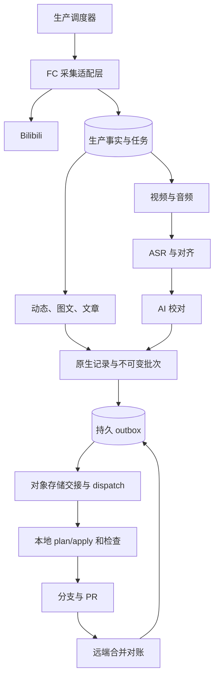

# 增量接收协议与外部发布设计

本文定义当前原生批次协议、权限、哈希、候选库与接收凭证。本地严格校验、规划、安装读回、凭证和仓库扩展校验已实现；云端传输、生产端 outbox、GitHub 接收和自动 PR 尚未启用，相关章节为待实现设计。操作见[维护说明](MAINTENANCE.md#增量批次)，实体和读取 Interface 见[数据结构](SCHEMA.md)。

唯一当前协议为 `contract_version=2`、`record_schema_version=3`、`kind=weimingzi_native_increment`。载荷是完整四实体原生记录，不带记录级版本；历史批次和收据按原字节保留，不作为新协议载荷重放。

## 设计决策与依据

| 决策 | 依据或责任 |
| --- | --- |
| 只接收目标仓库 `chosenecho/weimingzi-data` 的批次 | [固定运行策略](../src/weimingzi_corpus/ingest/policy.py) |
| Bilibili 目标 UID 为 `23191782` | 同上；转发和引用仍核对实际作者 |
| 采集由 `bilibili-api-zoku` 适配层负责 | 外部采集设计，接收内核不请求平台 API |
| 原生四实体、完整载荷、insert/replace | [批次 Schema](contracts/ingest-batch-v2.schema.json)、[合并守卫](../src/weimingzi_corpus/ingest/merge.py) |
| 一批候选一次整图校验，唯一 primitive 安装 | [records](../src/weimingzi_corpus/records.py)、[规划实现](../src/weimingzi_corpus/ingest/planning.py) |
| 原稿、AI 结果和人工证据分别保存 | [结构](SCHEMA.md)、[维护](MAINTENANCE.md) |
| 持久投递任务与远端对账 | 外部设计，调度并发不替代可靠队列 |

生产端接入前须固定可检出的代码、导出和验证版本，再形成原生批次；设计期工作树探测只说明当时状态，不是当前生产端或部署证据。本协议只约束本仓接收与保存，不依赖其他仓库消费方式。

## 运行拓扑

以下外部链路尚待接入，其中本地 plan/apply、校验与凭证内核已有实现：



生产端持有发现游标，先持久化响应与任务再推进状态。FC 不持有仓库写入凭据，也不运行 GPU ASR。ASR/AI 的模型、运行参数、冻结输入、修订身份、失败与重试留在生产端。对象存储资源尚未由本文确认；本地内核只接受下载完成的目录，使用 Python 标准库。

### FC 采集适配层

外部采集接口只接受固定 UID、资源类型、已发现对象及受限分页参数，覆盖视频、动态、文章详情、字幕和媒体描述，不接受任意 API URL。平台业务 API 经指定适配库，媒体流式下载、校验和 ffmpeg 可复用生产端处理。

响应区分成功、可重试失败与暂停，保存追踪、原业务快照、覆盖和下一页；失败不是空列表，部分成功不表示遍历完成。源站临时地址只留受保护控制面，不充当永久媒体定位。

## 发现与阶段交付

### 首次建立基线

首次启用先从目标仓库建立外部身份和结果索引，再关联生产库已有完成记录；发现历史内容不自动安排全部重下载、识别或校对。历史补采使用显式任务范围。

每轮持久化运行、页游标、覆盖和响应后推进已扫描位置。重叠扫描及定期核对发现置顶、旧内容编辑与迟到更新。失败、空响应和确认为空分别记账；HTTP 412、分页失败不产生“无新内容”结论，不推进未覆盖页。达到重试阈值后保留证据并暂停。

### 各阶段的提交条件

| 阶段 | 可交付 | 未完成时 |
| --- | --- | --- |
| 内容发现 | 条目、来源、已取得正文 | 截断与缺失明确标记 |
| 媒体归档 | 实际文件的资产与定位 | 保留不可用状态及来源 |
| ASR | 真实音频对应的转录、模型与时间 | 失败留生产端，不生成假转录 |
| AI 整理 | 文字、输入、疑点、完整性 | 局部输出保留待复核和不完整状态 |

阶段可分别成批，单项失败不阻塞其他已完成结果。同批可放入互引的新记录；依赖先前批次时，`requires_batches` 必须指向当前检出中受 Git 跟踪的新协议接收凭证，开放 PR 或历史旧收据不满足。`already_present` 不制造凭证，后续直接引用现有记录。冻结包不再追加结果。

<a id="身份映射与确定性投影"></a>

## 身份映射与原生记录

| 对象 | 匹配依据 | 冲突处理 |
| --- | --- | --- |
| 视频 | video 条目的 bilibili_bvid | 多候选暂停核对 |
| 分 P | bilibili_part，并核对 metadata.cid | CID 或分 P 变化不自动归并 |
| 动态 / 专栏 | bilibili_dynamic / bilibili_cvid | opus 对应关系须有采集事实 |
| 音频 | 文件 SHA-256 和字节数 | 同哈希不同大小为冲突 |
| 转录 | 本仓原生 content_sha256 | 上游摘要另存观测 |
| AI 结果 | 条目及上游修订身份 | 人工派生稿不冒充 AI 基线 |

保留既有内部 ID；模型别名、目录或标题变化不重新编号。分 P 的外部零起页索引须明确转换为仓库从一开始的 `part_number`，新 CID 不自动等同于旧音频。计数、运行时间、来源编号变化不新建正文结果，而以允许的追加观测登记。

正文或富文本确实改变则同条目新增文稿 ID，保存原结果。富文本、转发者附言、原作者、视频卡片和文章全文保留各自结构和关系，不用通用字段删除算法判断内容版本，也不从引用关系合并音频。

## 批次协议

[机器 Schema](contracts/ingest-batch-v2.schema.json)、[合成示例](examples/INGEST-EXAMPLES.md)和[本地解析实现](../src/weimingzi_corpus/ingest/manifest.py)共同固定当前形状与语义。运行时由本地严格解析器检查，不表示调用外部 JSON Schema 引擎。

交接目录只有 `manifest.json` 和清单列明的每记录 JSON，不接受 ZIP/TAR：

```text
<batch_id>/
  manifest.json
  records/items/<record_id>.json
  records/documents/<record_id>.json
  records/assets/<record_id>.json
```

通用路径规则为 `records/{entity}/{record_id}.json`，实体只有 `items`、`documents`、`assets`、`annotations`；自动生产端没有写 `annotations` 的权限。载荷是完整原生记录，物理写入位置由实体 Interface 决定，不直接把包内路径复制到维护目录。

| 必填字段 | 语义 |
| --- | --- |
| contract_version / kind / record_schema_version | 固定 2 / weimingzi_native_increment / 3 |
| target / source_scope | 固定目标仓库、分支与来源范围 |
| batch_id | 移除自身后的规范清单 SHA-256 |
| producer | 程序、代码修订和运行编号 |
| base_commit / created_at | 生产映射基线 / 首次封包时间 |
| requires_batches | 必须已有有效凭证的依赖批次 |
| sources | 平台身份、发布者、观测时间及链接 |
| files | 每个载荷的路径、字节数和原始字节摘要 |
| operations | 原生 insert/replace 及前置摘要 |

每个 operation 恰含 `op`、`entity`、`record_id`、`path`、`payload_sha256`、`expected_record_sha256`、`source_refs`；`op` 只有 `insert|replace`，预期摘要字段两者都必填，insert 为 null，replace 为 SHA-256。`source_refs` 绑定清单来源；非目标用户内容必须有来自目标内容的实际引用依据。文件摘要证明交接一致性，不证明来源事实真实。

### 哈希边界

规范 JSON 沿用 [canonical_json](../src/weimingzi_corpus/records.py)：UTF-8、键排序、紧凑分隔、未转义 Unicode、拒绝 NaN。解析拒绝重复键、非有限数和错误类型，布尔值不充当整数；跨语言实现需对照本仓测试。

- `files[].sha256` 覆盖文件原始字节，包括排版与末尾换行。
- `payload_sha256` 覆盖完整原生载荷的规范 JSON。
- `expected_record_sha256` 覆盖操作前完整原生记录，包含其 ID 和 metadata，不能用文稿内容摘要替代。
- `batch_id` 覆盖移除自身后的规范清单；外部信封 `manifest_sha256` 覆盖清单原始字节，不写回清单。
- 转录 `content_sha256` 覆盖 `document_hash_input` 的显式字段，定义见[结构说明](SCHEMA.md#工件恢复位置与哈希)。识别块数组摘要、历史输入摘要和文件字节摘要各自独立。

清单、文件、操作顺序及创建时间封包后固定；重新规划只绑定新的目标基线，不改包。改载荷或操作须形成新批次。

### 路径和容量规则

路径必须是规范相对字符串：不接受绝对路径、盘符、反斜杠、`.`/`..`、重复分隔、符号链接、硬链接载荷或大小写碰撞。清单不列自身，不列未被操作引用的文件；每操作独占一份载荷，同实体同 ID 在批内只出现一次。

[生效策略](../src/weimingzi_corpus/ingest/policy.py)限制清单 2 MiB、单载荷 16 MiB、载荷合计 64 MiB，文件及操作各最多 2000。它们是校验上限，不是吞吐承诺；[策略示例](examples/ingest-policy.toml)不覆盖受信代码。读取在容量边界停止，待实现的下载器也应提前或流式检查。

## 操作与合并规则

### `insert`

提交完整原生记录，`expected_record_sha256=null`。新 ID 新增；同 ID 同值返回 `unchanged`，不同值为 `RECORD_CONFLICT`。外部身份、音频哈希及转录内容仍检查重复，不能换 ID 绕过。接收端不猜测新 ID 或自动重写引用。

当前受信策略允许自动新增 items 的 video/video_part/post/article/video_collection，documents 的 transcript/edited_transcript/post/article，assets 的 audio/archive；通用实体结构允许更多 kind，不等于自动生产权限扩大。准确白名单以策略为准。

### `replace`

提交完整后置记录和原记录规范摘要；当前状态已精确等于后置状态时，先返回 `unchanged`，再对真正变化做前置摘要 CAS。CAS 不符为 `PRECONDITION_FAILED`，须重新核对或封包。

| 实体 | 允许变化 |
| --- | --- |
| items | 追加允许的 metadata 观测、urls、relations、members |
| documents | 追加允许的来源 metadata 观测 |
| assets | 追加允许的 metadata 观测、downloads，或同文件 audio 真实 unavailable→available |

追加保留旧数组前缀及顺序，不递归合并或排序。本次新增或变化的受许可 metadata 观测使用数组并保留旧前缀，嵌套数组仍为一次完整观测；已有标量、对象或其他历史事实保持原样。允许变更的观测键由受信策略列明，包括运行、源工件摘要、观测时间等；新增或变化的未知键失败。

已有正文、富文本、输入、模型、时间、质量、归属、已知文件哈希和身份保持不变。音频可用状态变化仍核对同文件 SHA-256/大小，保留已有恢复路径及下载项；来源定位声明不代替媒体实际回读。文字修订另建文稿。

### 人工维护保护

自动生产端不写 annotations，不创建人工确认、片段归属、人工派生修订、确认静音或全文审核事实。新 ASR/字幕保留机器和来源身份；新 AI 整理稿必须有模型、`requires_review=true`，且没有人工派生或参照继承。自动允许的质量键和状态由策略及合并守卫限定。人工记录、原疑点、输入快照、质量和来源链保持原值。

## 媒体、全文与可用性

视频与实际送入 ASR 的音频按各自字节核验；不同分 P、音轨或重编码分别保存。转录通过 `inputs` 的 `audio` 角色引用真正使用的资产；平台字幕与 ASR 并列，不互相冒充。

audio 与 archive 都在 `data/assets.jsonl`。audio 的 `downloads[].archive_id` 直接引用完整 archive 资产，保存原成员路径及 Release 定位；只有生产机文件、临时 URL 或未经回读的对象不表示满足恢复契约。不可用不推断静音。

视频、图片定位保存在条目 `metadata.media_assets` 观测，遵守[媒体 Schema](contracts/ingest-media-asset-v2.schema.json)。定位含内容 SHA-256、大小、MIME、固定存储别名、不可变对象键与版本及本生产运行的回读声明。别名由部署策略解释，包不能指定任意主机；预签名、Cookie 和过期播放 URL 不是永久定位。普通仓库检查只核结构和声明，不每次下载媒体。

文章保留正文、HTML、展开状态及质量，图文保留富文本和图片顺序。未展开、图片失败和上游删除分别记账；保存 JSON 不等于内容完整。现有独立工件保留原字节，批次不因四实体存在就获得任意工件写入权限。

## 本地入口与候选库算法

命令见[校验、规划与应用](MAINTENANCE.md#校验规划与应用)。`verify` 只检查包，不要求其独立成库；`plan` 构建完整候选图；`apply` 只接受未过期计划；`validate-repository` 核对新收据和媒体语义。

`plan_version=2`，`plan_id` 为移除自身后的规范计划摘要。计划绑定批次、原始清单、实际 HEAD、生产参考基线、完整输入字节快照、策略、内核、候选路径和摘要、操作结果、校验及冲突。结果为 `inserted`、`replaced`、`unchanged` 或 `conflict`；任一冲突阻止安装。

1. 确认目标是 Git 根、origin 为固定仓库且工作区干净，使用专用检出。
2. 加载原生记录、接收凭证和外部身份；先判断新协议已有接收凭证的历史接收状态，再判断依赖和本次 CAS。
3. 无凭证时，将全部操作放入隔离候选库，核对来源绑定、人工保护、媒体、引用和完整实体图。
4. 生成确定性目录和计数；有业务变化时生成版本 2 接收凭证，绑定计划并报告。
5. `apply` 取得 `.git/weimingzi-ingest-lock`，重新加载包、HEAD、输入、策略和内核，重算计划与报告比较。
6. 先持久写 `.git/weimingzi-ingest-incomplete.json`，调用 `records.install_candidate_updates` 安装实际变化路径，再读回全部摘要并核对 HEAD；全部成功才删除中断标记。

唯一安装 primitive 使用临时复制和单文件 `os.replace`，可捕获 I/O 失败尝试回滚；候选文件保留便于核验。逐文件替换不提供跨文件事务原子可见性。中断标记持续闭锁，专用检出应保留现场后从干净基线重建，不在日常工作树清理用户修改。本地锁只约束同机，跨机器发布需租约、分支前置条件与远端对账。

## GitHub 接收、PR 与重放

以下均是外部发布设计；事件名、对象键和部署权限须随当前 contract 2 一起验收，不沿用历史旧协议信封。

### 投递信封

事件仅携带协议身份、批次 ID、清单原始字节摘要和固定对象键，不带正文、下载主机、Git ref、目录、命令或秘密。接收方从受信配置取得存储和工具，核对触发身份、目标、对象键、清单及批次。值用结构化 JSON 解析，不拼入 shell。

采集、发布和只读检查的访问分开。计划使用仅作用于目标仓库的 GitHub App；工作流须先进入默认分支，再验收真实机器人 PR 的触发、检查、权限与合并行为。设计不是当前平台配置声明。

### 生产端 outbox

持久 outbox 以 `(repository, batch_id)` 唯一，保存冻结包、来源运行、依赖、状态、尝试/退避、租约、分支/PR/head 和见证提交。生产事实、范围游标及投递意图可靠提交后异步封包；上传与回读完成才标 ready。通知送达不删除 outbox。

失去执行、取消或回执丢失时先查询远端分支、PR 和主分支凭证，再有界重投。Actions 并发控制仅作第二层串行约束，不能替代 outbox；生产端重启、补偿扫描与对账不自动重做已有 ASR/AI。

### 发布过程

首版最多一个开放自动入库 PR，其余 ready 留队列。每批固定分支和 PR；重投复用，已关闭未合并者暂停，显式恢复仍重新核基线。发布从受信主分支加载工具，在专用检出运行 plan/apply 与检查，只推计划允许的数据、目录和凭证变化，不运行包中的代码。

推送前复查 main 与机器人分支 head，main 移动则重算，有人工提交则暂停保留；不强推覆盖。必需检查及基分支更新条件须上线验证。PR 展示各实体变化、来源、媒体和质量，不把检查通过写成人工校对。默认不自动合并。

## 接收凭证与状态机

有业务变化时加入 `ingest/receipts/<batch_id>.json`，`receipt_version=2`、`kind=weimingzi_native_receipt`、`contract_version=2`、`record_schema_version=3`。凭证记录批次、原始清单摘要、生产者、来源、应用基线、操作及接收摘要，不写自己的提交/PR 或提前标 merged。

已有有效新凭证先于本次旧 CAS 判定，返回 `status=replayed`：`replay_status=accepted_state_present` 表示接收状态仍在，`accepted_state_changed` 表示后来已有变化；后者 `accepted_state_changed` 列表列出 entity、record_id、accepted_sha256、current_sha256。它如实区分历史接收和当前状态，不改原凭证，不把后续维护变化当成历史接收失败，也不自动恢复已被撤回的内容。

无凭证且全部操作后置状态已满足为 `already_present`，不造空凭证；实际见证提交留外部回执。历史旧收据作为不透明原字节快照保护，不用新语义重新验证或重放，也不满足新 `requires_batches`。

外部状态设计为 building→uploading→ready→dispatched→validating，随后 already_present、conflict/failed→retry_hold，或 planned→pr_open→merged/rejected。merged 须由远端合并事实及目标分支实际凭证或结果确认；工作流成功、PR 关闭、源分支存在均不替代。合并后回滚须记录并暂停重放。对账可从推送、建 PR、回执丢失的任一点恢复。

## 错误分类与恢复

| 错误码 | 处理 |
| --- | --- |
| UNSUPPORTED_CONTRACT / PACKAGE_INTEGRITY_FAILED | 保留包与证据，修正版本或文件 |
| SOURCE_SCOPE_VIOLATION / IDENTITY_AMBIGUOUS / CID_CHANGED | 暂停并核对来源与身份 |
| RECORD_CONFLICT / PRECONDITION_FAILED | 核对现状后新建结果、重新计划或封包 |
| BASE_MOVED / DEPENDENCY_PENDING | 重新 plan / 等待有效依赖 |
| MEDIA_UNVERIFIED / WRITE_PERMISSION_DENIED | 完成媒体核验或回人工维护流程 |
| BATCH_ID_COLLISION | 保留冲突，不复用该身份 |
| WORKTREE_INCOMPLETE / LOCAL_IO_ERROR | 保留中断现场，排除原因后重建专用检出 |

批次 CLI 退出码：成功含无变化 0，协议/语料/完整性错误 2，身份/内容冲突 3，过期计划/依赖/锁等前置条件 4，本地 I/O 5。以失败 JSON 的 `code`、`exit_code` 和冲突明细为准，不凭退出码无限重试；其他 CLI 不因此改成同一退出约定。

远端分支被修改、回滚、网络暂时故障和 PR 被关闭属于待实现发布端状态，先对账再决定暂停或有界重试。日志保留批次、来源、大小、耗时和错误，不记录 Cookie、访问密钥、预签名 URL 或请求头；完整业务快照与尝试留生产端。

## 运行状态与保留策略

采集持平台会话；处理端持媒体与模型访问；发布持交接只读和目标仓库访问；普通检查只读。范围、存储别名、App 身份和权限来自受信配置，不从包扩张。

运行面板应反映最近成功发现、未覆盖页、待处理任务、暂停原因、待投递批次、最早等待、开放 PR 与最近接收，来自实时事实和对账。登录失效、连续失败、冲突、依赖长等及媒体失效按配置阈值提示，恢复保留事件。

冻结包不覆盖，原始快照、媒体、失败尝试、收据各按归档策略保留。首版不自动清理；dispatch 成功或 PR 关闭不删除唯一副本。Git 留原生记录、定位与精简凭证，完整运行日志留生产端。

## 模块与实施顺序

| 位置 | 当前责任 |
| --- | --- |
| ingest/manifest.py | 严格清单、来源、载荷和媒体解析 |
| ingest/merge.py | 原生 insert/replace、身份、CAS 和人工保护 |
| ingest/planning.py | 候选图、计划绑定、锁、安装和读回 |
| ingest/receipts.py | 版本 2 凭证与历史接收状态报告 |
| ingest/policy.py | 固定范围、允许字段/kind 与容量 |
| records.py / schema_v3.py | 原生读取、哈希、唯一安装及整图校验 |
| tools/check_repository.py | 仓库、文档链接、专题和接收扩展检查 |
| 外部发布与采集适配 | 待实现部署、outbox、PR、远端对账和调度 |

先完成本地原生内核与合成协议验收，再固定部署访问、存储与工作流验证合成 PR，之后分别验收真实动态、文章、视频及分阶段交付，最后启用有覆盖证据的持续发现与对账。实施结果以当前[原生整理记录](NATIVE-V3-CLEANUP.md)和真实检查为准。

## 验收矩阵

| 场景 | 应观察到的结果 |
| --- | --- |
| 同批互引条目、资产与文稿 | 候选完整图校验后安装 |
| 同值 insert / 相同后置 replace | unchanged，早于旧摘要冲突 |
| 新 ID 重复外部身份或同 ID 异值 | 冲突，不自动归并 |
| 元数据计数变，正文不变 | 允许的观测追加，原结果保留 |
| 真正改文字或富文本 | 新文稿，原正文/时间/快照不覆盖 |
| 自动输入写人工证据或已审核 | 权限失败 |
| 音频新增可恢复定位 | 同文件身份、完整 archive 引用、原下载项保留 |
| 时间异常 | 原值与质量证据保留，字幕失败不伪修 |
| HEAD/输入/策略/内核变化 | 旧计划失败并重算 |
| 安装中断、读回失败 | 持久标记闭锁，不发布半批 |
| 新收据重放后记录已变 | replayed/accepted_state_changed，列出差异且保留凭证 |
| 旧收据存在 | 原字节保留，不成为新协议依赖 |
| 远端推送/PR/回执丢失 | 待实现发布端对账恢复同批身份 |
| 无业务变化 | already_present，无空业务 PR 或伪凭证 |

协议附件为批次与媒体 v2 Schema、策略示例和原生合成包。全量检查、媒体回读及外部投递的完成状态只由对应实际证据说明，历史测试与探测不替代本次验证。
