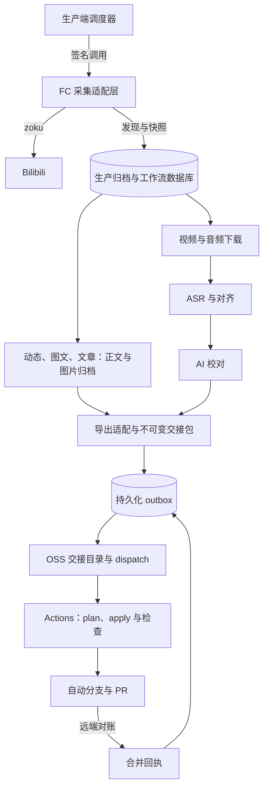

# 增量接收协议与外部发布设计

本文保存批次输入协议、边界、错误、候选库算法及外部发布设计。已实现的是本地严格校验、规划、受限操作、安装读回、接收凭证和仓库扩展校验；云端传输、生产端 outbox、GitHub Actions 接收和自动 PR 尚未启用，相关章节为设计要求。当前操作命令集中于[维护说明](MAINTENANCE.md#增量批次)，实体和术语见[数据结构](SCHEMA.md)；训练选稿与发布分工见 [README](../README.md#与训练工程协作)。

文档合并、更名与维护格式 v3 均不改变已实现的输入协议：批次清单 `record_schema_version=2`，完整载荷 `schema_version=2`，逻辑表与原生四实体分别解释。本文不是新增兼容接口或部署完成声明。

## 设计决策与依据

| 决策 | 依据或责任 |
| --- | --- |
| 仅向 `chosenecho/weimingzi-data` 提交 | 本次服务范围 |
| 目标 Bilibili UID 为 `23191782` | 本次服务范围 |
| 采集继续使用 `bilibili-api-zoku` | 本次指定的采集库 |
| 接收载荷继续使用逻辑记录版本 `schema_version: 2`，由适配器写入 v3 维护实体 | [输入协议][s]、[校验][v] |
| 本地命令处理数据，发布任务处理网络和 Git | [现有 CLI][cli] |
| 同一批次在候选库中统一校验 | 跨表引用及人工维护保护 |
| 原稿、AI 整理稿、人工确认分别保存 | [概念][g]、[维护][m] |
| 生产端持久化投递任务 | 避免把 Actions 并发调度当成可靠队列 |

设计期的生产端工作树检查曾发现 `bili-asr corpus export`、`corpus verify`、`--identity-from`，涉及 `src/bili_asr/corpus/`、`src/bili_asr/cli/corpus.py` 和 `docs/guides/corpus-export.md`，当时尚未提交。这是历史检查记录，不代表当前生产端状态。接入前仍须固定可检出的生产端代码版本，并以其交接快照运行适配器；本文不修改生产端工作树，也不据此宣称已部署。

## 运行拓扑

以下为待接入的外部拓扑；其中调用的本地 `plan`、`apply`、校验及凭证内核已实现，不代表图中的云资源和发布链路已部署。



首版由生产端调度器调用 FC 并持有发现游标。FC 只返回采集结果，不持有仓库写入凭据，不运行 GPU ASR。生产端负责持久化响应与待处理任务后再推进扫描状态。这样可沿用现有工作流数据库，不为此入口新增分布式任务系统。

ASR 和 AI 校对沿用 `bilibili-asr-archive` 的处理契约，按目标用户和目标仓库配置隔离范围。模型、运行参数、冻结输入和已提交修订继续由生产端登记；下游不从机器目录名推断模型身份。运行失败和人工暂停重试也留在生产端。

OSS 是设计拟采用的交接与原始媒体存储，本文不确认资源已创建。仓库入口不依赖 OSS SDK：网络下载完成后，入库内核只接收本地目录，继续使用 Python 标准库。GitHub API 与对象存储访问由待实现的发布脚本适配。

### FC 采集适配层

生产适配层另建接口，不改变现有探测函数及其固定样本证据。签名调用只接受固定 UID、资源类型、已发现对象身份及受限分页参数；不接受任意 API URL 或任意用户选择。资源覆盖视频列表、动态列表、专栏列表、各类详情、平台字幕和媒体下载描述。

响应分别返回成功、可重试失败或需暂停的错误，同时保留请求追踪、实际覆盖范围、原始业务快照和明确的下一页信息。失败不能伪装为空列表，部分成功不能宣称已遍历完成。生产端收到响应后仍需自行可靠登记。

平台业务 API 统一经过 `bilibili-api-zoku` 适配器；媒体字节的流式下载、校验及 ffmpeg 处理可以复用原工作流。源站下载地址只在受保护的生产控制面使用，不写入永久媒体定位。接入原处理引擎时，需对照检查仍直接调用平台业务 API 的路径，避免绕过指定采集库。

## 发现与阶段交付

### 首次建立基线

首次启用先检出目标仓库，建立外部身份和已有结果索引，再把生产库中已存在的完成记录关联到这些身份。发现历史视频不等于自动安排全部历史视频重新下载、识别或校对。首次扫描仅登记已知项与待核对项；历史补采使用显式任务范围。

每轮发现保存扫描运行、页游标、覆盖范围和平台响应结果。只在本轮对应响应已持久化、待处理任务已可靠登记后推进已扫描位置。分页中断保留未覆盖部分；置顶、旧内容编辑和迟到更新通过重叠扫描及定期核对发现，不只比较发布时间。

设计期发现探测曾有动态列表和视频分页失败，相关证据留在生产端项目，上线前须重新验证。失败、空响应、确认为空分别记账；HTTP 412 不生成“无新内容”结论。达到重试策略阈值后记录暂停和证据，等待恢复，不形成无界自动重试。

### 各阶段的提交条件

| 阶段 | 可交付数据 | 尚未完成时的处理 |
| --- | --- | --- |
| 内容发现 | 条目、来源、已取得的全文 | 截断或缺失正文明确标记 |
| 媒体归档 | 音频记录、视频及图片定位 | 保留待下载状态和原始来源 |
| ASR 完成 | 真实音频对应的转录、模型与时间段 | 失败记录留生产端，不生成假转录 |
| AI 校对完成 | 整理稿、输入关系、疑点和完整性 | 部分结果显式标记，失败不冒充完整稿 |

每个阶段均可形成交接批次；一个视频的失败不阻塞其他已完成内容。需要先前批次提供记录时，使用 `requires_batches` 等待其接收成功，或把所需记录一起放入本批次。依赖不能仅以“已有开放 PR”为满足条件。

`requires_batches` 只列出会在 Git 内留下接收凭证的批次。若先前阶段返回 `already_present`，适配器直接引用已在 main 的记录并在生产端保存见证，不制造不存在的凭证依赖。

默认在封包前聚合本轮已就绪的正文和新视频条目。同一视频的 ASR 与 AI 整理稿通常一起交付；AI 长期失败时，ASR 可单独交付并保留待校对状态。已经冻结的包不再追加产物，后续结果进入新批次。

## 身份映射与确定性投影

| 对象 | 匹配依据 | 冲突处理 |
| --- | --- | --- |
| 视频 | `kind=video` 与 `bilibili_bvid` | 多个候选拒绝猜测 |
| 分 P | 既有 `bilibili_part`，同时核对 `metadata.cid` | CID 或分 P 映射变化进入身份暂停 |
| 动态 | `bilibili_dynamic` | 沿用既有条目 ID |
| 专栏 | `bilibili_cvid`，经采集确认的 opus 对应关系 | 不能只凭相似正文认定同一篇 |
| 音频 | 文件 SHA-256 与字节数 | 同哈希、不同字节数拒绝 |
| 转录 | 消费侧 `content_sha256` | 原始上游哈希另存来源元数据 |
| AI 基线修订 | 条目与上游修订身份 | 人工派生稿不作为 AI 基线 |

消费者保留现有记录 ID，不因改目录、模型别名或标题变化重新编号。分 P 的零起始页索引与仓库的一起始 `part_number` 由适配器明确转换；不能把发现到的新 CID 自动等同于旧音频。

生产端适配器先用目标仓库建立身份映射，再输出规范记录。正文相同但本次运行时间、计数或来源编号变化时，复用原记录，使用受限补充操作登记来源；不重新生成一份不同字节的同 ID 记录。动态中的浏览量、点赞量等易变统计留在原始快照，不因计数变化创建正文版本。

动态或文章确有正文、富文本节点、图片或引用变化时，保留同一内容项，新增正文结果 ID。原始平台响应完整归档到生产端；正文修订判定使用显式、按内容类型定义的字段投影，不能用通用“删除所有未知字段”的方式丢弃富文本。

转发正文、目标用户附言、视频卡片和文章全文分别保留关系与作者。不能把动态中的视频卡片当作目标用户上传的视频，也不能据参照关系合并音频。

## 批次协议

协议定义见 [batch JSON Schema](contracts/ingest-batch-v1.schema.json)。[合成示例](examples/INGEST-EXAMPLES.md) 给出可解析的交接包；不代表真实平台内容。

该接收协议仍使用 [v2 逻辑记录][s]：清单的 `record_schema_version` 为 2，完整记录载荷的 `schema_version` 为 2。当前仓库采用 [schema v3](SCHEMA.md)，版本只由 `data/schema.json` 声明。接收器读取旧字段投影并经适配器写入四实体；载荷中的 `segments`、`paragraphs`、`audio_ids` 等字段和逻辑表名不表示仓库仍使用旧物理目录。

交接目录只包含 `manifest.json` 和清单列出的 JSON 文件。传输时按固定对象键逐文件下载，首版不接收 ZIP 或 TAR，避免压缩包展开语义与路径映射混入入库逻辑。

```text
<batch_id>/
  manifest.json
  records/items/<record_id>.json
  records/posts/<record_id>.json
  records/transcripts/<record_id>.json
  observations/items/<record_id>.json
```

交接包按每条记录一个 JSON 文件组织，`records/transcripts/` 等是包内逻辑路径。写入 v3 时，条目与集合映射到 `data/items.jsonl`，稿件映射到 `data/documents/<id>.json`，音频及归档映射到 `data/assets.jsonl`，确认与归属位于 `data/annotations.jsonl`。独立参照稿及 HTML 写入资产引用的 `data/artifacts/`；包内路径不决定目标路径。

清单主要字段：

| 字段 | 语义 |
| --- | --- |
| `contract_version` / `kind` | 交接协议身份 |
| `record_schema_version` | 接收载荷的逻辑记录版本，固定为 2；与维护格式 v3 分开 |
| `target` | 固定仓库和目标分支 |
| `batch_id` | 清单规范内容的 SHA-256 |
| `producer` | 程序名、代码修订、运行编号 |
| `source_scope` | 固定目标平台与用户 |
| `base_commit` | 生产端建立身份映射时的仓库提交 |
| `created_at` | 首次封包时间，重投不得重写 |
| `requires_batches` | 必须先接收的批次 |
| `sources` | 平台身份、实际发布用户、观测时间与来源链接 |
| `files` | 路径、原始字节 SHA-256、字节数 |
| `operations` | 操作、表、记录、载荷和前置条件 |

`sources` 中的身份由可信生产端负责采集。消费者核对目标范围、关联关系和来源引用，但文件哈希只证明交接内容一致，不能证明平台事实真实。非目标用户内容须有来自目标用户内容的明确引用依据，无法解释的越界内容拒绝自动入库。

### 哈希边界

规范 JSON 直接沿用 [canonical_json](../src/weimingzi_corpus/records.py)：UTF-8、键排序、紧凑分隔、`ensure_ascii=False`、拒绝 NaN。解析额外拒绝重复键、非有限数、BOM 之外的非法编码，以及把布尔值当作整型版本或计数。跨语言实现必须以此实现的测试向量对照，不能混用其他规范化算法。

- `files[].sha256` 覆盖载荷文件原始字节，包括排版和末尾换行。
- `payload_sha256` 覆盖载荷解析后的规范 JSON。
- `expected_record_sha256` 覆盖操作前整条 v2 逻辑记录的规范 JSON；v3 目标先还原旧字段视图，不对原生文件 JSON 求该哈希。
- `batch_id` 覆盖移除 `batch_id` 字段后的整个规范清单。
- `manifest_sha256` 是投递信封中的清单原始字节哈希，不写回清单。
- 转录的 `content_sha256` 仍只覆盖现有语料契约规定的字段，不能用上述哈希替代。

清单、文件顺序和操作顺序封包后固定。重复投递复用原包；重新规划不改包，计划记录新的目标基线。生产端重新封包或改变操作后得到新身份，重复结果仍由记录规则去重。

### 路径和容量规则

路径必须与规范相对路径字符串完全一致，拒绝绝对路径、盘符、反斜杠、`.` / `..`、重复分隔符、符号链接、硬链接载荷和大小写碰撞。清单不能包含自身，也不能包含未被操作引用的文件。每个操作引用一个独占载荷；同一批次内，同一表和 ID 只能出现一个操作。

协议结构与语义须同时满足机器可读 Schema 和[本地校验实现](../src/weimingzi_corpus/ingest/manifest.py)；运行时由本地实现严格检查形状、路径与表/ID 的匹配、容量、来源引用、哈希、操作适用范围和依赖关系，不表示调用了外部 JSON Schema 引擎。

当前[运行策略](../src/weimingzi_corpus/ingest/policy.py)实际限制清单为 2 MiB、单载荷为 16 MiB、全部载荷合计为 64 MiB，文件数和操作数各不超过 2000。这些是校验限额，不是实测性能承诺；[策略示例](examples/ingest-policy.toml)不覆盖代码中的生效策略。本地读取在容量边界停止；待实现的下载端也须在下载前或流式读取时检查，不先全部载入内存。

## 操作与合并规则

首版定义 `insert`、`enrich`、`attach_audio_distribution`。现有单表 `import` 保持原行为；自动入口不调用它逐表修改正式检出目录。

### `insert`

允许 `items`、`audio`、`transcripts`、`edited_transcripts`、`posts`、`articles` 和 `collections`；不接受 `confirmations` 或训练选稿。载荷为完整语料记录，`expected_record_sha256` 必须为 null。

新 ID 新增；同 ID 且规范记录相同返回 `unchanged`；不同则返回 `RECORD_CONFLICT`。还需检查外部身份重复、音频哈希重复和重复转录，防止用新 ID 绕过去重。身份归并由生产端重新投影完成，消费者不临时改 ID 和重写跨表引用。

### `enrich`

载荷为受限补充对象，结构见 [补充操作 Schema](contracts/ingest-enrichment-v1.schema.json)。所有新增值按规范 JSON 判等，保留原顺序，按载荷顺序追加缺少值。`metadata` 的每个值仍是一组观测；嵌套数组作为一次完整观测，不能递归展开合并。

| 表 | 可补充字段 |
| --- | --- |
| `items` | 已允许的 `metadata`、`urls`、有依据的 `relations` |
| `transcripts` | 来源 `metadata`、已验证同源的 `audio_ids` |
| `edited_transcripts` | 来源 `metadata` |
| `posts` | 来源 `metadata`、`article_item_ids` |
| `articles` | 来源 `metadata` |
| `audio` | 来源 `metadata`、已验证同文件的 `item_ids` |

元数据键由受信策略逐表列白名单。初始包括来源运行与上游结果编号、原始内容哈希、观测时间、展示标题观测和 `media_assets`；未知键报错，不自动放行。真实 UID、BV、CID、记录归属、模型、正文、时间段、质量判断和人工状态不能通过 `enrich` 改写。新 CID 或身份别名需要单独核对，不以补充元数据绕过。

操作先判断全部补充是否已存在，已满足则返回 `unchanged`；否则必须与 `expected_record_sha256` 匹配。前置条件不符返回 `PRECONDITION_FAILED`，重新规划或重封包，不静默覆盖。

### `attach_audio_distribution`

只作用于已有 `audio`，载荷为完整的目标音频记录。核对现有 SHA-256、字节数、ID 和既有内容关联，允许从明确不可分发转为已验证可分发，或给已可分发音频追加镜像。已有定位、还原路径和关联不删除；其他业务字段不得变化。

定位结构遵循现有 Release 契约：本地还原路径、Release 标签、ZIP 名、成员路径、归档 SHA-256、字节数与 HTTPS 地址完整。相同目标已满足则跳过，否则检查整条记录的前置哈希。定位校验不等于文件可达性核验，媒体工作进程须先完成上传和回读验证。

同一音频还需要补充内容关联或来源元数据时，先完成独立的 `enrich` 批次，再登记分发位置；不能借完整目标音频记录修改其他字段。

### 人工维护保护

自动输入不能新增人工确认或修改训练选稿，不能把新 ASR / AI 记录标记为已完成人工审核。自动 AI 整理稿保留 `requires_review: true`，`is_complete` 与实际完成范围一致。既有人工派生稿、疑点、输入快照、选稿、确认和来源链继续保留。

已有正文需要修订时新增结果 ID；标题的显示值调整、身份变化、删除和任意字段替换进入单独维护 PR，不属于本协议的自动操作。

## 媒体、全文与可用性

视频下载任务保存视频和实际送入 ASR 的音频；不同分 P、音轨或重新编码结果按各自文件核验。ASR 的 `audio_ids` 指向真正使用的音频。平台字幕可以并行补充，但不能用它的成功代替用户要求的音频 ASR。

当前音频及其归档位于 `data/assets.jsonl`，接收载荷仍使用 `audio` 逻辑记录，首版自动分发沿用 GitHub Release 定位。生产机存在文件、OSS 有原始备份、源站临时播放地址可用，都不能直接宣称满足当前音频的可还原契约；没有分发定位时明确记为不可分发，不推断静音。

视频和图片的接收载荷以条目 `metadata.media_assets` 观测保存类型化定位，每个观测对象遵循[媒体定位 Schema](contracts/ingest-media-asset-v1.schema.json)，当前写入也保留为条目元数据观测。维护侧已有 v3 资产实体，不表示本协议会把任意视频或图片定位自动提升为独立资产；输入协议不新增通用媒体操作，包内路径不直接创建或覆盖资产。

媒体定位保存内容 SHA-256、字节数、MIME、存储别名、不可变对象键和对象版本。固定存储别名由部署策略解析，不接收批次指定的任意存储主机。预签名 URL、带 Cookie 的 URL 和会过期的播放地址不作为永久定位。

生产媒体工作进程上传后回读核对文件，再封存交接包。发布任务核对允许的存储位置、对象版本、大小及可信生产端验证声明；对象自报的哈希元数据不能独立证明字节已核验。普通仓库检查验证定位结构，不每次下载全部媒体。后续可单独运行媒体可达性与抽样完整性检查。

文章保留取得的正文、HTML、展开状态及质量信息；图文保留富文本和图片顺序。未展开全文、图片下载失败和上游删除分别保留状态，不以“已保存 JSON”代表内容完整。原始来源链接与已归档媒体定位分别保存。

## 本地入口与候选库算法

本地命令及检出、报告路径的操作步骤统一见[校验、规划与应用](MAINTENANCE.md#校验规划与应用)。以下说明已实现的算法与报告契约。

`verify` 检查包的结构、容量、哈希、语义与来源范围，不要求增量包本身构成完整语料库。`plan` 在当前仓库上构造完整候选库，检查所有引用、操作、媒体字段与目录生成，输出可应用报告或冲突报告。`apply` 只接受可应用且基线未过期的计划。`validate-repository` 检查已入库的批次凭证和类型化媒体字段，由既有仓库检查流程调用。

计划包含 `plan_version`、`plan_id`、`batch_id`、`manifest_sha256`、`target_commit`、生产端参考 `base_commit`、策略与内核代码版本、受影响文件哈希、操作结果、候选文件哈希、校验结果及冲突。`plan_id` 覆盖移除自身后的规范计划；运行日志时间不进入该计划。

报告的操作结果为 `inserted`、`enriched`、`distribution_attached`、`unchanged` 或 `conflict`。任一冲突使整个计划不可应用；不能只装入碰巧成功的部分。需要拆分时由生产端生成新的独立批次，不能在消费端悄悄删掉失败操作。

实施算法：

1. 目标根目录默认为当前仓库，异地检出用 `--root` 指定；固定仓库身份和策略由受信代码限定，不从包内读取。`plan`、`apply` 均要求 origin 指向目标仓库、根目录确为 Git 根且工作区干净，发布使用独立检出目录。
2. 加载当前语料、批次接收凭证及外部身份索引，记录实际基线和文件哈希。
3. 核对依赖在当前检出中已有受 Git 跟踪的接收凭证，判断 `already_accepted` 或 `already_present`；开放 PR 不满足依赖。外部发布者负责确保检出基线确实来自目标 main，本地内核不请求远端合并状态。
4. 在隔离目录投影所有操作；一次性放入相互引用的新记录，再调用整库校验。
5. 调用现有目录生成器，得到 `docs/INDEX.md`、`docs/catalog/`、`docs/counts.json` 的确定性输出。
6. 验证改动路径、人工保护、类型化媒体及批次凭证，写出计划。
7. 应用时重新加载包、策略、目标提交和受影响文件，重新计算计划并比较，不能相信可被编辑的报告。
8. 获得本地目标写入锁后安装已验证结果，立即读回并核对文件集和哈希；全部成功才允许发布。

锁只防止同机重复写入；跨机器以生产端单一发布调度器、远端分支前置条件和远端状态复查约束。不能用过期的锁文件自动判断另一个发布者已经死亡。

普通逐文件替换不是跨文件事务。应用中断留下 `incomplete` 标记；发布脚本看到该标记必须停止。独立检出目录直接作废重建，不在日常维护工作树中自动回滚或清除用户修改。计划和应用均不在用户当前有未提交改动的工作树执行。

## GitHub 接收、PR 与重放

### 投递信封

拟新增事件 `weimingzi_ingest_v1`，使用 `repository_dispatch`，同时提供 `workflow_dispatch` 运维重放入口。工作流必须先进入目标仓库默认分支，才启用自动发送。事件只传固定对象键和哈希，不传正文或秘密：

```json
{
  "event_type": "weimingzi_ingest_v1",
  "client_payload": {
    "contract_version": 1,
    "batch_id": "<64 位十六进制 SHA-256>",
    "manifest_sha256": "<清单原始字节 SHA-256>",
    "object_key": "handoffs/weimingzi-data/v1/<batch_id>/manifest.json"
  }
}
```

接收者核对事件类型、触发主体的配置身份、固定仓库、对象键前缀、批次身份及清单哈希。桶和端点来自部署配置，载荷不能指定下载 URL、Git ref、工作目录或命令。事件值通过环境变量和结构化 JSON 读取，不能直接插入 shell 代码。

外部接入设计选用仅安装于目标仓库的 GitHub App，按角色分配权限；上线时按 [dispatch 接口文档][github-dispatch]核对令牌和仓库权限要求。采集 FC 不持有 App 私钥，发布角色取得内容写入及 PR 写入，日常检查保持只读，默认分支通过保护规则禁止直接写入。

设计拟用 App 安装令牌创建和更新 PR；上线时按 [Actions 触发文档][github-trigger]及实际仓库设置，验证 App 与 `GITHUB_TOKEN` 的事件触发、审批及必需检查行为。本文不把设计期对触发规则的判断作为当前平台事实，也不以“已创建 PR”代替检查完成；必须用真实机器人 PR 验收。

### 生产端 outbox

拟在生产端保留持久化的 `ingest_outbox`，与已冻结交接包绑定：

| 字段组 | 内容 |
| --- | --- |
| 身份 | 目标仓库、批次、清单哈希、对象键 |
| 来源 | 触发阶段、生产运行、依赖批次 |
| 进度 | 状态、尝试次数、下一次尝试、最后错误 |
| 租约 | 拥有者、到期时间、心跳 |
| GitHub | 分支、PR、远端 head、见证提交 |

以 `(repository, batch_id)` 唯一。生产端从已提交的处理事实生成分发意图，事实键和范围游标与意图一起提交，再异步封包。冻结批次登记与意图关联在同一事务中完成，重启后继续未完成意图；不能只在模型完成事件中发送一次通知，也不能只用墙钟时间去重。

OSS 上传是外部操作，先登记上传中任务，校验完成再变为 `ready`。上传中断可重做，不能在对象未冻结时发送 ready 事件。消费端基线重建和生产端事实扫描均可恢复意图，但不能因此自动重跑已有识别或校对。

发送收到的 API 成功只表示触发请求被接受，不删除 outbox。未见执行、执行取消或回执丢失时，先查询 PR 和主分支接收凭证，再按退避策略重投。错误的包或身份冲突进入暂停，不无限重发；重试保留所有尝试记录。

工作流使用固定并发组，`cancel-in-progress: false`，避免新任务取消正在发布的任务。但 [Actions 并发控制][github-concurrency] 的等待有容量与顺序限制，不能代替 outbox；取消的等待任务由对账和重投恢复。

### 发布过程

首版最多保持一个开放的自动入库 PR。其他 ready 批次留在 outbox 等待，人工审核耗时不占用 Actions 执行进程。依赖已合并的待处理批次按生产端顺序推进；永久失败批次不阻塞无依赖的其他内容。

分支名固定为 `codex/ingest/<batch_id>`。同一批次只对应一个 PR；重投先查远端分支、开放和已关闭 PR、主分支接收凭证。已关闭未合并的 PR 进入 `rejected`，不自动重新打开；显式重放可以恢复原批次，但仍重新核对基线。

工作流从受信默认分支加载入库工具，重新取得当前 main，在独立检出目录生成候选变更，再执行现有数据、目录和工具检查。推送范围仅允许：

```text
data/items.jsonl
data/assets.jsonl
data/annotations.jsonl
data/documents/*.json
data/artifacts/*.md
data/artifacts/*.html
docs/INDEX.md
docs/counts.json
docs/catalog/*.md
ingest/receipts/<batch_id>.json
```

逐条修改仍受操作规则约束；路径允许不等于任意覆盖该文件。凭证中出现不在上述范围的变更必须失败。交接包内没有可执行代码，接收流程不执行 PR 中的脚本或工作流。

检出需取得核对接收与回滚所需的 Git 历史；首版配置完整历史检出。发布者在生产 outbox 的唯一租约内执行派发和重试；Actions 并发控制是第二层限制，不单独解决跨运行的排他问题。

推送前复查 main 和已有机器人分支 head。main 变化则重新规划；机器人分支存在未预期的人工提交时暂停，不能强推覆盖。旧计划不直接套到新 main。已有机器人 PR 如需跟随 main，先在受控分支完成合并和目录重生成，再创建普通后继提交；与人工改动冲突时暂停。

复查与推送之间仍可能发生并发更新，因此 main 还须启用必需检查，并要求 PR 分支在合并前与基分支保持更新，见 [分支保护规则][github-protection]。这是上线配置要求，本文没有读取或修改当前仓库保护设置。

PR 标题、正文模板和标签由发布程序生成，正文引用批次 ID、来源范围、各表变化、媒体可用性、ASR 与 AI 状态和检查结果。不把“检查通过”写成人工校对完成。默认不自动合并。

## 接收凭证与状态机

产生实际业务差异的批次，在 PR 中同时加入 `ingest/receipts/<batch_id>.json`。凭证是确定性的应用证明，保存批次身份、原始清单哈希、生产端身份、来源摘要、实际应用基线、操作结果及修改记录的前后哈希。它不写自己的提交 ID、PR 编号或“已合并”，避免循环依赖和提前确认。

main 中已有同名凭证时，批次和原始清单身份必须一致；同批次不同清单拒绝为 `BATCH_ID_COLLISION`。已有接收凭证不根据新计划重写，后续人工修改记录不会反过来把历史接收判为失败。未合并机器人分支的凭证可以随受控重新规划更新，但须核对预期 head，且不能据此声称已接收。

没有凭证且所有期望结果已在 main 中满足的批次返回 `already_present`，保存实际 main 见证提交和逐项结果到生产端回执，不为了增加一条接收日志创建空业务 PR。音频分发位置或受限补充已是超集时，按操作后置条件判断，不要求所有既有记录字节回到旧状态。

生产端运行回执包含批次、实际执行、PR、head、接收见证提交、错误和重试决策，可多次追加。运行回执与 Git 内的应用凭证分别管理：

```text
building → uploading → ready → dispatched → validating
                                     ├→ conflict / failed → retry_hold
                                     ├→ already_present
                                     └→ planned → pr_open → merged
                                                        └→ rejected
```

`merged` 必须来自远端合并事实，并确认对应凭证或被采纳的操作结果确在目标 main。PR 关闭事件、工作流完成事件和源分支存在都不能代替它。主分支包含接收凭证但后来回滚，标记回滚事件并暂停原批次自动重放，避免自动恢复维护者明确撤回的内容。

对账由生产端定期查询远端状态，PR 关闭事件可作为加速信号而非唯一依据。推送成功但建 PR 失败，从远端分支恢复；建 PR 成功但回执失败，按分支和批次重新定位；合并后回执丢失，按主分支凭证恢复。

## 错误分类与恢复

下表中除远端分支、回滚、网络及 PR 错误外，均对应本地内核的已实现错误；`BRANCH_MODIFIED`、`ROLLBACK_DETECTED`、`REMOTE_TRANSIENT`、`PR_REJECTED` 是待实现发布端的设计错误，不代表当前 CLI 可执行相应远端恢复。

| 错误码 | 恢复行为 |
| --- | --- |
| `UNSUPPORTED_CONTRACT` | 暂停，升级适配器或消费者 |
| `PACKAGE_INTEGRITY_FAILED` | 暂停，保留损坏证据 |
| `SOURCE_SCOPE_VIOLATION` | 暂停，检查来源与配置 |
| `IDENTITY_AMBIGUOUS` / `CID_CHANGED` | 暂停，核对身份 |
| `RECORD_CONFLICT` | 暂停，生成冲突报告 |
| `PRECONDITION_FAILED` | 对照现状重新投影或重封包 |
| `BASE_MOVED` | 从新基线重新 plan |
| `DEPENDENCY_PENDING` | 保留 outbox 等待依赖 |
| `MEDIA_UNVERIFIED` | 等待媒体核验，不伪造可用状态 |
| `BATCH_ID_COLLISION` | 暂停，不复用远端分支 |
| `BRANCH_MODIFIED` / `ROLLBACK_DETECTED` | 暂停，等待维护者处理 |
| `WORKTREE_INCOMPLETE` | 丢弃专用检出目录后重建 |
| `LOCAL_IO_ERROR` | 保留本地错误及中断证据，检查磁盘、权限或路径后重建专用检出 |
| `REMOTE_TRANSIENT` | 先对账，再有界退避重试 |
| `PR_REJECTED` | 停止自动重投，保留批次 |

当前 `ingest` CLI 已使用以下退出码：成功含无变化为 `0`；协议、语料或完整性错误为 `2`；身份或内容冲突为 `3`；过期计划、未满足依赖、锁占用等前置条件为 `4`；本地 I/O 错误为 `5`。该约定只描述批次子命令，不统一改变其他 CLI 的错误码。失败 JSON 的 `code`、报告中的冲突明细和 `exit_code` 是细分依据，不凭退出码无限重试。发布端暂时故障的分类及重试仍属待实现设计。

日志只记录批次、来源对象身份、字节数、耗时、错误码和重试决策；不记录 Cookie、SESSDATA、访问密钥、预签名 URL 或完整请求头。原始业务响应保存在生产端指定位置并保留关联，不把私有运行目录和供应商证据全部复制进公开 PR。

## 运行状态与保留策略

部署凭据按组件隔离：

| 组件 | 所需访问 |
| --- | --- |
| FC 采集 | Bilibili 会话 |
| 生产调度与媒体处理 | FC 签名调用、媒体写入、模型服务 |
| 发布任务 | 交接目录只读、目标仓库 App |
| 普通仓库检查 | 仓库只读 |

存储别名、来源白名单、App 身份和权限来自受信部署配置，不能由交接包扩大。FC 采集会话与 AI 服务凭据不进入 GitHub 检查任务。

生产端提供按目标用户汇总的状态：最近成功发现时间、未覆盖页范围、待下载和待识别任务、暂停原因、待投递批次、最早等待时间、开放 PR 及最近接收提交。状态来自实时数据库和远端对账，不能用上次探测结果充当当前生产进度。

登录失效、连续发现失败、批次身份冲突、PR 检查失败、依赖长期等待和媒体定位失效触发运维提示。告警阈值由部署配置给定；普通重试不重复发送同一故障提醒，恢复后记录恢复事件。

交接包冻结后不可覆盖，原始快照、媒体、失败尝试和接收凭证按各自归档策略保留。首版不设置自动清理；清理策略另行明确恢复窗口和归档责任，不能在“dispatch 成功”或“PR 被关闭”时删除唯一副本。Git 内只保存语料、类型化定位和精简凭证，完整尝试日志留在生产端。

## 模块与实施顺序

| 位置 | 责任 |
| --- | --- |
| `src/weimingzi_corpus/ingest/manifest.py` | 已实现：严格解析、清单、来源和媒体语义校验 |
| `src/weimingzi_corpus/ingest/merge.py` | 已实现：身份索引、受限操作和冲突检查 |
| `src/weimingzi_corpus/ingest/planning.py` | 已实现：候选库、绑定计划、加锁安装及读回 |
| `src/weimingzi_corpus/ingest/receipts.py` | 已实现：接收凭证校验和确定性生成 |
| `src/weimingzi_corpus/ingest/policy.py` | 已实现：固定身份、白名单和容量限额 |
| `tools/check_repository.py` | 已接入：校验已入库回执及类型化媒体定位 |
| `tools/publish_ingest.py` | 待实现：OSS、Git 发布、PR 对账 |
| `.github/workflows/ingest.yml` | 待实现：受信入口、并发和最小权限 |
| 生产端适配器与 outbox | 待实现：导出转换、媒体核验、持久投递和对账 |

实施按依赖推进：

- 本地消费内核：已完成严格读取、插入、受限补充、候选库、冲突报告、音频分发登记、视频和图片定位校验、应用凭证及中断恢复。
- 合成 PR：待固定 GitHub App、对象存储策略和受信工作流，再验证投递、PR 检查、拒绝和合并回执。
- 真实内容：待对动态、文章和视频分别验收，再验证同视频的条目、媒体、ASR、AI 分阶段补充。
- 持续运行：待修复发现接口、建立基线、重叠扫描与对账，满足验收后再启用调度。当前探测函数不直接改为生产发布函数。

## 验收矩阵

| 场景 | 必须观察到的结果 |
| --- | --- |
| 新条目和引用它的稿件同批到达 | 候选库一次校验成功 |
| 原批次重复投递或执行中断后重投 | 不重复记录、分支或 PR |
| 新 ID 携带既有外部身份 | 拒绝重复建档或要求重新映射 |
| 计数、观测时间变化，正文不变 | 复用结果，受限登记来源 |
| 真正修改动态或文章正文 | 旧稿保留，新结果可追溯 |
| AI 产物试图标记人工完成 | 拒绝自动输入 |
| 人工派生稿和训练选稿已存在 | 入库前后保持原值 |
| 音频先不可分发、后上传成功 | 同文件身份增加有效定位 |
| 视频或图片只有临时 URL | 不通过永久媒体定位校验 |
| 时间段倒退或精度不可表示 | 保留证据，不排序钳制，不绕过导出检查 |
| 列表 412、分页不完整 | 不推进未覆盖范围，不报告无新内容 |
| 两个生产阶段重复包含同一条目 | 已存在项跳过，完整引用仍成立 |
| 计划后 main 或策略变化 | 拒绝旧计划并重新规划 |
| 载荷路径逃逸、重复键、超限或坏哈希 | 修改前失败 |
| 推送成功但 PR 创建响应丢失 | 查询远端恢复同一 PR |
| PR 被关闭、回滚或人工修改机器人分支 | 暂停并保留证据，不覆盖维护者操作 |
| 等待的 Actions 被取消 | outbox 对账后重投，无丢件 |
| 无实际业务差异 | `already_present`，无空业务 PR |

协议交付物包括本文、批次与补充操作 Schema、媒体定位 Schema、策略示例和合成包。本地内核的实际能力以代码、运行策略和测试为准；云端投递、采集适配、自动 PR、远端回执及其验收场景仍是待实现设计，生产端历史探测记录不替代上线验证。

[s]: SCHEMA-V2.md
[v]: ../src/weimingzi_corpus/records.py
[cli]: ../src/weimingzi_corpus/cli.py
[g]: SCHEMA.md
[m]: MAINTENANCE.md
[github-dispatch]: https://docs.github.com/en/rest/repos/repos#create-a-repository-dispatch-event
[github-trigger]: https://docs.github.com/en/actions/using-workflows/triggering-a-workflow
[github-concurrency]: https://docs.github.com/en/actions/using-jobs/using-concurrency
[github-protection]: https://docs.github.com/articles/about-protected-branches
