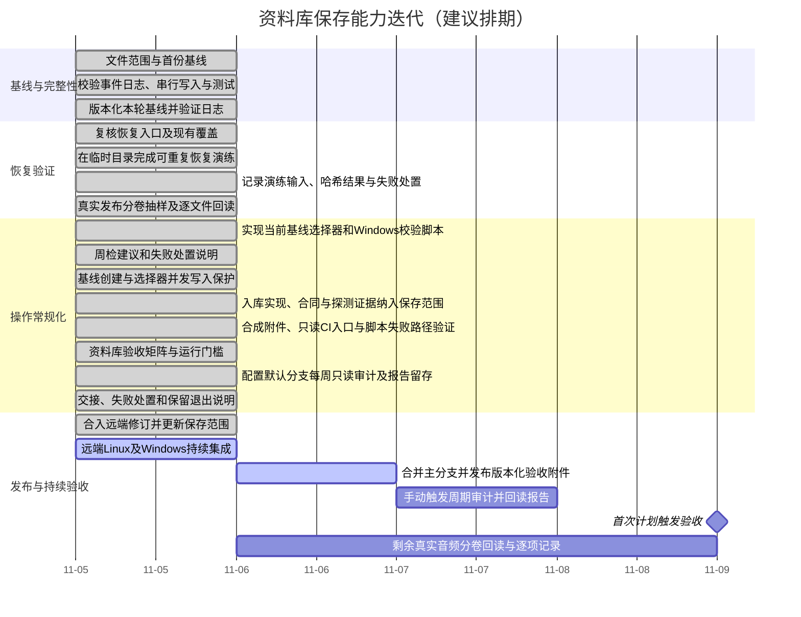

# 保存能力迭代计划

本计划按当前仓库能力拆成可验收的小步。日期是建议排期，用于安排执行顺序，不代表外部标准规定的期限。当前先完成本地校验和恢复证据；第二保存副本暂缓，等保存位置确定后再排期。

图中已完成项按实际完成日期记录。恢复验证包括本地测试夹具与真实单卷抽样，不代表全部音频包或未来时刻可访问。第二保存副本不纳入日期计划；它依赖用户指定已有位置以及确认权限、保留期和费用上限。

| 迭代 | 交付物 | 验收条件 | 状态 |
| --- | --- | --- | --- |
| 0. 范围与基线 | `preservation/manifests/` 中的版本化 SHA-256 清单 | 覆盖维护数据和解释上下文；校验无差异；排除项明确 | 已完成 |
| 1. 校验留痕 | `preservation/checks/fixity.jsonl` 事件链 | 成功和失败均有记录；可发现链内编辑和不完整末行；测试通过 | 已完成；完整末尾事件被删除仍需外部历史发现 |
| 2. 恢复演练 | 合成演练与真实单卷抽样记录 | 核对归档、成员和恢复文件哈希；记录输入、范围和限制；维护数据不被修改 | 已完成合成演练及真实单卷抽样；全库待验收 |
| 3. 定期运行 | 当前基线选择器、Windows脚本、每周只读审计及报告 | 手动触发通过；报告回读；保留首次计划触发证据 | 本地通过；远端待验收 |
| 4. 发布验收 | 合并提交、CI 运行和 Release 附件 | Linux/Windows 检查通过；附件哈希与发布版本一致 | 进行中 |
| 5. 全量媒体回读 | 其余真实分卷逐项记录 | 归档、成员与恢复文件全部核对，失败原样保留 | 单卷抽样通过；其余待执行 |
| 6. 维护交接 | 操作说明及接收记录 | 负责人、替补、访问恢复、保留和退出责任明确 | 说明已补；人员与接收待确认 |
| 7. 独立副本 | 用户选定位置的副本及回读证据 | 位置属于独立故障域；回读内容与清单一致；权限和保留策略明确 | 暂缓 |
| 8. 独立副本恢复 | 从独立副本恢复的记录 | 恢复结果与原清单匹配，流程和缺口均有记录 | 依赖第 7 项 |

每个迭代结束时保留版本化操作说明和可复核结果。基线出现变化时先确认数据或上下文改动是否获准，再另建基线；校验差异本身不能自动作为新基线。

验收定义、证据入口与尚未完成的运行门槛见[资料库验收矩阵](ARCHIVE-ACCEPTANCE.md)。CI 使用只读入口核对当前基线与事件链，Windows 脚本的失败码另有临时仓库回归测试；工作流实际运行结果以远端记录为准。

周期审计在 GitHub 默认分支运行，不绑定临时工作树。手动触发、报告回读、失败处置和责任交接见[运行说明](PRESERVATION-OPERATIONS.md)。计划日期用于安排工作；人员交接和第二副本在条件确定前不虚列完成日期。
