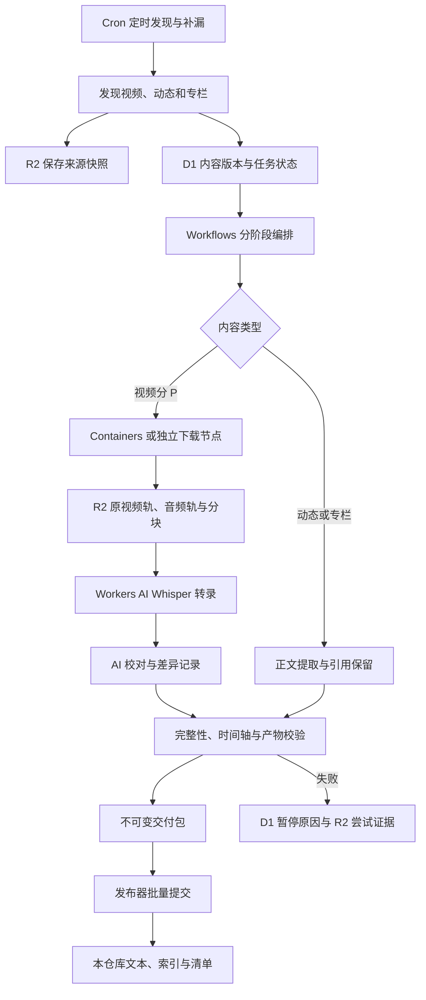

# UID 23191782 增量监听与归档项目

状态：设计提案；尚未实现或部署。方案核对日期：2026-11-04（Asia/Hong_Kong）。

目标：持续发现 B 站 UID `23191782` 的新内容及修订，保存来源与媒体原件，完成音频转录和 AI 校对，再向本仓库交付可追溯的文本产物。

## 架构选择

建议使用 Cloudflare Cron Triggers、Workflows、D1、R2 和 Workers AI。媒体下载、封装与音频分块交给可替换的下载执行器。优先验证 Cloudflare Containers；如果其网络出口无法稳定取得源内容，替换为独立下载节点，保持其余流程和交付格式一致。

Cloudflare Containers 支持完整运行时、文件系统和现有容器镜像，适合承载下载工具与 FFmpeg。[1] 普通 Workers 的每个 isolate 内存为 128 MB；Cron 有 CPU 和墙钟时间限制，不应将完整媒体解码与归档链路塞进一次定时调用。[2]



Git 保存文本、轻量来源元数据、校对差异和对象清单；R2 保存媒体、大体积原始响应和完整调用证据。D1 是运行状态库，Git 是发布结果，不靠 Git 提交历史充当任务队列。

## 监听范围与首次启动

建议默认收录该用户发布的视频及全部分 P、动态和专栏。转发动态保存该用户的文字与原文引用，引用对象的上传者单独记录，不自动归入该 UID 的原创视频。合集、系列变化可后续接入；直播录制属于另一个任务范围。

以下频率是实现建议，需依据实际访问响应和费用调整：

- 增量发现每 10 分钟运行；近期内容滚动复查，每日做分页补漏。
- 文本与索引每 30 分钟批量发布，紧急归档可单独触发。
- 首次运行先导入本仓库现有来源索引作为基线，再保存当前发现结果；已收录且输入未变化的内容不重新下载或转录。历史补采使用单独开关、游标与预算。

Cron 使用 UTC 表达式；展示时间使用 Asia/Hong_Kong，持久化时间使用带时区的 UTC 时间。[3]

发现逻辑需要分别维护每种内容的分页游标与重叠扫描窗口。置顶内容、发布时间相同的内容和分页重排都不能只靠“最新一条时间戳”去重。只有分页完整成功且原始响应落盘后才推进游标；发现版本与待处理任务先持久化，另由补偿调度器启动 Workflow。

源内容身份与源版本分开记录：

- 视频分 P 使用平台、BV 与 CID 标识，页码只是可变展示字段；动态、专栏使用各自的源 ID。
- 每次采集保留原始响应哈希；正文、分 P 列表或媒体身份变化才产生业务修订，播放量等波动不触发重复 ASR。
- 保存 `source_uid`、原始 URL、发布时间、首次发现时间、采集时间、内容哈希和修订关系。
- 暂时访问失败只产生访问失败记录；删除或不可访问状态单独留证，不删除已经保存的原件。

本次未进行 B 站接口与 Cloudflare 出口的端到端测试。具体接口、鉴权要求和签名逻辑须由适配器实测确定，不能把本机访问成功当作边缘出口可用的依据。

## 组件职责

| 组件 | 职责 |
| --- | --- |
| 发现 Worker | 定时扫描、版本识别、补漏 |
| D1 | 游标、任务、租约、尝试、暂停 |
| Workflows | 阶段恢复、重试、等待下载结果 |
| 下载执行器 | 获取媒体、探测、分块、哈希 |
| R2 | 来源原件、媒体、调用和交付包 |
| Workers AI | ASR 与候选校对模型 |
| 发布器 | 校验交付、合并提交、登记回执 |

单用户的第一版先用 Workflows 与 D1；出现吞吐或执行器分发需求后再加 Queues。Workflow 非流式步骤结果和事件载荷上限为 1 MiB，步骤间传 R2 引用与摘要，不传媒体或整份长转录。[4]

Cloudflare Containers 与独立节点实现同一下载协议：领取指定任务、续租、上传产物、提交带哈希的 manifest。执行器在下载时重新解析可用媒体地址，不长期保存会失效的直链作为唯一恢复手段。

大文件直接通过受限的 R2 上传凭据或预签名分段请求上传，避免经普通 Worker 请求体中转。执行器临时磁盘只用于处理，R2 完整性确认后才算归档完成。视频原轨、音频原轨分别留存；合并播放文件是派生物。

## ASR 与 AI 校对

首选试验模型为 `@cf/openai/whisper-large-v3-turbo`。官方模型页提供语言、VAD、提示词等参数，输出 schema 包含正文及可选的 segments、VTT 和置信信息。[5] 需要通过中文样本验证术语、人名、长句、静音区和时间轴，不能仅凭返回正文判断转录成功。

处理顺序：

1. 保留源字幕响应，检查正文是否可用；即使存在字幕轨，也不能把空白字幕当作成功或认定音频无声。第一版仍按约定生成独立 ASR 版本。
2. FFmpeg 生成可独立解码的音频块，保存原音频偏移、块长度、格式和哈希。建议从每块 120 秒、相邻重叠 1 秒开始试验；这是调优起点，不是平台限额。
3. 显式设置中文转录任务；按块持久化请求参数和响应，成功的块可复用，失败只补对应块。实际单次请求的时长、字节限制与超时需用目标账户实测。
4. 将块内时间映射回原音频时间，依据重叠音频与文本对齐去重。每段记录来源块和偏移；边界冲突进入待复核，不能简单拼接文字。
5. 校对模型输出结构化修订，定位到稳定段 ID，保存修改前后内容、理由和不确定项。允许修正听写、标点和术语，不补写论点或证据。
6. 保留 ASR 原文、校对稿、差异和调用证据；AI 校对不自动获得人工审核标签。只有结构校验通过的修订才能应用。

官方提供大音频分块教程，但其中按字节切片的示例不作为本项目的媒体处理实现。[6] 本项目按时间生成独立可解码音频块，并在 FFmpeg/解码验证后提交推理。

ASR 与校对采用独立 provider 接口。校对可先测试 Workers AI 上的中文模型，再与现有校对结果抽样对比；模型、提示词或配置变更创建新的处理版本，旧产物继续保留。

## 质量关口与故障恢复

视频处理状态建议为：

```text
discovered → archived → downloaded → chunked → transcribed
           → proofread → validated → packaged → published
```

动态、专栏从来源归档进入正文提取与校验，跳过媒体与 ASR 阶段。任一阶段都可以进入 `retry_wait` 或 `held`；恢复仅从该阶段开始。

- 每阶段幂等键由稳定内容身份、源修订、阶段、输入哈希、模型和配置哈希组成；Workflow ID 使用有界长度的摘要。
- 使用 D1 条件更新领取租约，并带租约版本校验完成回调。过期执行器不能覆盖新任务；重复事件和回调返回已有结果。
- 不宣称外部推理调用恰好一次。响应丢失时可能重复计费，必须记录调用尝试并设置预算。
- 网络超时、限流、服务端临时错误按阶段退避重试；鉴权或余额错误进入暂停。无效字幕可以按策略转向 ASR，但必须保留字幕失败证据。
- 时间轴回退、缺块、媒体损坏、校对结构错误进入 `held`，保留原产物与错误；修复原因后显式重排对应阶段。
- 音频存在与静音判断需要媒体探测或音频检测证据；空字幕和空 ASR 响应不能单独证明无声。
- 时间轴要求非负、结束晚于开始、开始时间不回退，并处于音频时长范围内；不排序、不截断、不钳制异常时间来通过校验。
- 发布前核验所有必需块和产物、对象大小与 SHA-256、来源身份、清单路径、质量回执及模型调用记录。

Workflow 自身完成状态有保留期限，应把长期证据保存在 D1 和 R2，不能只依赖平台日志。[4] 监控至少展示各阶段积压、最早未完成时间、最后成功扫描、失败原因、暂停项和费用消耗。

## 存储与发布

建议使用以下逻辑目录；每个修订目录写入后不覆盖：

```text
R2: sources/bilibili/23191782/<kind>/<source-id>/<revision>/...
R2: media/bilibili/<BV>/<CID>/<media-revision>/...
R2: runs/<run-id>/attempts/<stage>/<attempt-id>/...
R2: deliveries/<bundle-id>/...
Git: data/monitoring/23191782/<kind>/<source-id>/<revision>/...
Git: metadata/monitoring/23191782/...
Git: provenance/monitoring/23191782/...
```

Git 中保存阅读稿、原始转录 JSON/VTT、校对差异、轻量来源快照和对象清单。大体积原始 API/模型响应保留在 R2，Git 用摘要与哈希定位。清单记录 bucket、key、大小、SHA-256、类型和原始来源；不提交会失效的签名 URL 或凭据。

R2 中的完整交付包与 Git 的阅读视图分开。完整交付包包含 ASR/AI 请求、响应、失败尝试、校对稿和所声明的文本证据，可独立下载并通过现有语料工具接入；不能将 Git 中的轻量子集冒充完整交付包。

发布器先收集已校验交付包，在独立 ingest 分支原子提交一批文件并创建或更新 PR；CI 通过并合并后才登记 `published` 与目标 commit。PR 阶段另记 `submitted`，避免把提交到分支当作已经发布到主分支。

一次只允许一个发布器推进目标分支；冲突时重新基于远端最新状态生成提交，已登记的 bundle ID 不重复导入。生成稿与人工编辑稿使用不同路径；索引通过适配器更新，不覆写已有人工修订。

运行凭据使用 Cloudflare Secrets、执行器私密配置与 GitHub App。原始响应只保留内容证据，落盘前去掉认证 header、Cookie、临时令牌等秘密；凭据不随调用证据进入 Git 或公开 R2。媒体访问与分发延续仓库的 [内容权利说明](../../CONTENT-RIGHTS.md)。

## 与现有语料工具衔接

当前仓库的 [CORPUS.md](../../docs/CORPUS.md) 与 `src/weimingzi_corpus/pipeline.py` 已定义独立内容输入及生产交付契约。新监听项目拥有自己的采集状态，不读取或修改既有生产数据库。

- 动态和专栏通过 `wm-corpus import-local --records` 接入，至少提供稳定的 `record_id`、`text`、`source.platform`、`source.source_id` 和 `source.group_id`。
- 视频转录交付 `asr-delivery/v1`，通过真实生产关口后提供 `quality.status=passed`、`quality.gate=production-minimum/v1`、`kind` 与非空 `provenance`。
- `records.jsonl`、文件哈希和 bundle ID 遵循现有 `bundle.py`；使用相同规范 JSON 算法，不另造不兼容的 manifest。
- 音频/视频不塞入现有离线交付包；包内保存媒体对象清单，并保留完整文本证据。`wm-corpus ingest` 消费从 R2 下载的完整交付包，`verify` 验证本地包；远端媒体完整性由发布器另行验证并留回执。
- `passed` 只表示已执行的生产关口，不代表人工复核或训练批准。下游修改后沿用现有 `downstream-edited` 规则。
- 同一稳定 record ID 的新修订保存为另一个快照，遵守现有合并冲突规则，显式选择版本，不为了合并而伪造新内容身份。

新目录默认不自动进入训练或知识库；仍经 Silver 快照和用途 profile 选择，防止重复源版本混入同一份训练数据。

## 费用口径

下列价格来自 2026-11-04 核对的官方文档，实际账单按账户使用量和届时定价计算：

- Whisper Turbo 模型页为每音频分钟 0.000513 美元；总价页按每分钟 46.63 Neurons 计，按每千 Neurons 0.011 美元折算相符，美元栏做了舍入。[5][7]
- 示例假设输入为 100 小时，且没有重叠、重试或重复推理：`100 × 60 × 0.000513 = 3.078` 美元。这是抵扣免费额度前的 ASR 用量估算，不是整个系统月费。[5]
- Workers AI 每日免费额度为 10,000 Neurons，跨模型共用；不能将每日额度简单合并成可任意使用的月度余额。[7]
- R2 Standard 为每 GB-month 0.015 美元，另计读写操作；有免费存储和操作额度，直接 R2 出网免传输费。[8]
- 下载执行器、Containers 内存/磁盘/CPU、可能的出网、Workers、Workflows、D1、校对与 GitHub 执行资源均需单独计入；Containers 需要 Workers Paid。[1][9]

视频保留体积需要先用实际样本测量。设置每日新增音频分钟、媒体字节、推理调用和校对 token 预算；预算用尽后暂停付费阶段，保留发现结果与待处理状态。

## 实施顺序与验收

第一步验证真实来源与网络。选择该 UID 的实际视频及文字内容，分别验证发现、翻页、详情、媒体解析和重新取直链；记录 Cloudflare 与候选独立节点的响应、错误和重试表现。完成后再确定默认下载位置。

第二步打通一份视频分 P 的纵向链路：原件进 R2、探测与分块、Whisper、校对、质量关口、交付包、本地 ingest/verify、发布分支。选含术语、静音和分块边界的样本，检查漏字、幻觉、边界重复与时间轴。

第三步加入定时发现、基线、修订检测、动态和专栏适配器，再接入批量 PR 发布与监控。历史回填在增量链路稳定后单独启动。

部署前至少验证：

- 同一批发现重复运行，内容版本和已成功阶段不重复产生。
- 下载、分块 ASR、校对及发布中断后，从失败阶段恢复。
- 余额不足、源接口限流、空字幕、时间轴回退均保留证据并走各自状态。
- 新分 P、修改正文和分页重排能被补漏发现；播放量变化不重跑 ASR。
- 交付可被现有语料工具校验；人工修改和旧生产回执不被覆盖。
- 发布冲突或主分支合并前崩溃，可按 bundle ID 和 commit 对账恢复。

后续实现建议在本目录拆分 `worker/`、`downloader/`、`publisher/` 与 `contracts/`。本提案没有创建云资源、推理任务、定时器或远端提交。

## 官方资料

1. [Cloudflare Containers](https://developers.cloudflare.com/containers/)
2. [Workers limits](https://developers.cloudflare.com/workers/platform/limits/)
3. [Cron Triggers](https://developers.cloudflare.com/workers/configuration/cron-triggers/)
4. [Workflows limits](https://developers.cloudflare.com/workflows/reference/limits/)
5. [Whisper-large-v3-turbo](https://developers.cloudflare.com/workers-ai/models/whisper-large-v3-turbo/) · [输入 schema](https://developers.cloudflare.com/workers-ai/models/whisper-large-v3-turbo/schema-input.json) · [输出 schema](https://developers.cloudflare.com/workers-ai/models/whisper-large-v3-turbo/schema-output.json)
6. [Whisper 大音频分块教程](https://developers.cloudflare.com/workers-ai/guides/tutorials/build-a-workers-ai-whisper-with-chunking/)
7. [Workers AI pricing](https://developers.cloudflare.com/workers-ai/platform/pricing/)
8. [R2 pricing](https://developers.cloudflare.com/r2/pricing/)
9. [Containers pricing](https://developers.cloudflare.com/containers/platform/pricing/)
